<picture>
  <source media="(prefers-color-scheme: dark)" srcset="assets/hero-dark.svg"/>
  <source media="(prefers-color-scheme: light)" srcset="assets/hero-light.svg"/>
  
</picture>

<a href="mailto:Lzbedat3@gmail.com"></a>
<a href="https://www.linkedin.com/in/lama-zbedat-763165341"></a>

<a href="https://darb.co.il/en">
<picture>
  <source media="(prefers-color-scheme: dark)" srcset="assets/sections/darb-dark.svg"/>
  <source media="(prefers-color-scheme: light)" srcset="assets/sections/darb-light.svg"/>
  
</picture>
</a>

<a href="https://caramel.darb.co.il">
<picture>
  <source media="(prefers-color-scheme: dark)" srcset="assets/sections/caramel-dark.svg"/>
  <source media="(prefers-color-scheme: light)" srcset="assets/sections/caramel-light.svg"/>
  
</picture>
</a>

<picture>
  <source media="(prefers-color-scheme: dark)" srcset="assets/sections/before-the-pour-dark.svg"/>
  <source media="(prefers-color-scheme: light)" srcset="assets/sections/before-the-pour-light.svg"/>
  
</picture>

<a href="https://github.com/lzbedat3/darb-caramel"></a>

<a href="https://raghad.darb.co.il"><picture>
  <source media="(prefers-color-scheme: dark)" srcset="assets/cards/raghad-beauty-dark.svg"/>
  <source media="(prefers-color-scheme: light)" srcset="assets/cards/raghad-beauty-light.svg"/>
  
</picture></a>
<a href="https://portfolio.darb.co.il"><picture>
  <source media="(prefers-color-scheme: dark)" srcset="assets/cards/nours-world-dark.svg"/>
  <source media="(prefers-color-scheme: light)" srcset="assets/cards/nours-world-light.svg"/>
  
</picture></a>

<picture>
  <source media="(prefers-color-scheme: dark)" srcset="assets/sections/toolbox-dark.svg"/>
  <source media="(prefers-color-scheme: light)" srcset="assets/sections/toolbox-light.svg"/>
  
</picture>

<picture>
  <source media="(prefers-color-scheme: dark)" srcset="https://raw.githubusercontent.com/lzbedat3/lzbedat3/output/stitches-dark.svg"/>
  <source media="(prefers-color-scheme: light)" srcset="https://raw.githubusercontent.com/lzbedat3/lzbedat3/output/stitches-light.svg"/>
  
</picture>

<picture>
  <source media="(prefers-color-scheme: dark)" srcset="assets/sections/say-hi-dark.svg"/>
  <source media="(prefers-color-scheme: light)" srcset="assets/sections/say-hi-light.svg"/>
  
</picture>

